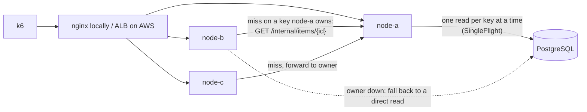

# HotShield

A distributed load shield for PostgreSQL under hot-key traffic. Concurrent cache misses for the same key are
coalesced into one query, popular keys are owned by one node in a small cluster via rendezvous hashing, and writes
invalidate cached copies. Terraform for AWS (ECS Fargate, RDS, ALB), traced with OpenTelemetry.



Each node keeps a bounded Caffeine cache. On a miss, the node asks the key's owner (rendezvous hashing over
the node list) instead of the database, and concurrent misses for one key share a single in-flight load on
each node. A `PUT` writes to Postgres, bumps the row's `version`, and broadcasts an invalidation to every
node; a version check on cache fills stops a slow read from caching a row older than the latest write.

`hotshield.mode` switches the same build between `direct`, `cache`, `coalesce` and `distributed`, so every
experiment runs the same code.

## Results

One EC2 `c7i.2xlarge` (8 vCPU) runs k6, the app and PostgreSQL 16, open-loop load, 60 s measured after a
discarded warmup, 0 dropped iterations in every measured phase. Each row is a single run.

Zipf(1.1) reads over 1M rows, one node, 3000 req/s:

| Mode | DB queries/s | DB queries per request | p50 (ms) | p99 (ms) | Error % |
|---|---|---|---|---|---|
| Direct PostgreSQL | 3008.1 | 1.0000 | 0.34 | 1.69 | 0.000 |
| Cache only | 674.8 | 0.2251 | 0.22 | 1.29 | 0.000 |
| Cache + coalescing | 674.7 | 0.2250 | 0.22 | 1.18 | 0.000 |

Direct mode first failed at 4000 req/s (6.374% errors). The cause was mostly the load generator: k6 started
10,000 VUs, each with its own connection. With VUs sized for the real concurrency, direct mode ran 4000, 5000
and 6000 req/s with 0 errors (p99 2.30, 2.75 and 4.80 ms); 6000 is the highest rate tried.

Thundering herd: a PUT drops the hot key, then 200 reads of it arrive together (50 ms artificial DB delay):

| Mode | Queries in the second after the PUT | Burst p50 / p99 (ms) |
|---|---|---|
| Cache only | 152 | 557.6 / 1064.8 |
| Cache + coalescing | 63 (the run averaged 50.4 per second) | 51.8 / 55.8 |

Three nodes (1 vCPU each) behind nginx, zipf, 1000 req/s:

| Mode | DB queries/s | DB queries per request | p50 (ms) | p99 (ms) | Error % |
|---|---|---|---|---|---|
| Three independent caches | 346.5 | 0.3464 | 0.48 | 2.60 | 0.000 |
| Distributed (one owner per key) | 279.2 | 0.2794 | 0.37 | 13.64 | 0.000 |

On AWS (us-east-2): three Fargate tasks (1 vCPU each) behind an ALB, RDS PostgreSQL 16 `db.m7g.large`, k6 on a
`c7g.large` in the same AZ, zipf at 500 req/s, fresh tasks for each mode:

| Mode | DB queries/s | DB queries per request | p50 (ms) | p99 (ms) | Error % |
|---|---|---|---|---|---|
| Direct PostgreSQL | 500.3 | 1.0000 | 1.89 | 14.27 | 0.000 |
| Three independent caches | 195.0 | 0.3891 | 1.78 | 9.06 | 0.000 |
| Distributed (one owner per key) | 159.5 | 0.3198 | 1.92 | 19.69 | 0.000 |

At 1000 req/s the 1 vCPU tasks ran at 100% CPU and the run failed (1.512% errors). Stopping one of the three
tasks at 500 req/s caused no failed requests: the other nodes read the database directly for the dead node's
keys until the replacement was healthy, about 172 s after the stop.

Every run, including the ones that failed and why, is logged in [docs/EXPERIMENTS.md](docs/EXPERIMENTS.md);
the run plan is in [loadtest/README.md](loadtest/README.md).

## Running locally

```bash
docker compose up -d
./gradlew bootRun   # Flyway creates the table on startup
# in another shell, once the app is up:
docker compose exec -T postgres psql -U hotshield hotshield < loadtest/seed.sql   # 1M rows
```

Java 21 and a running Docker daemon required (tests use Testcontainers). Compose publishes Postgres on host port
5434 (override with `PG_HOST_PORT`) so a locally installed Postgres on 5432 is never used by mistake.

Three nodes behind nginx, with Jaeger on :16686:
`docker compose --profile cluster up -d --build` (add `TRACING=-javaagent:/app/opentelemetry-javaagent.jar`
for traces).
