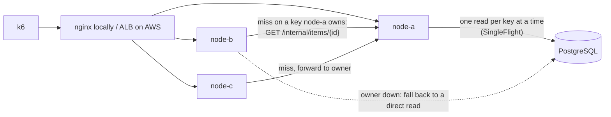

# HotShield

A distributed load shield for PostgreSQL under hot-key traffic. Concurrent cache misses for the same key are
coalesced into one query, popular keys are owned by one node in a small cluster via rendezvous hashing, and writes
invalidate cached copies. Terraform for AWS (ECS Fargate, RDS, ALB), traced with OpenTelemetry.

> Work in progress. Results below get filled in from real benchmark runs.



Each node keeps a bounded Caffeine cache. On a miss, the node asks the key's owner (rendezvous hashing over
the node list) instead of the database, and concurrent misses for one key share a single in-flight load on
each node. A `PUT` writes to Postgres, bumps the row's `version`, and broadcasts an invalidation to every
node; a version check on cache fills stops a slow read from caching a row older than the latest write.

`hotshield.mode` switches the same build between `direct`, `cache`, `coalesce` and `distributed`, so every
experiment runs the same code.

## Results

| Mode | DB queries/s | p50 | p99 | Error % |
|---|---|---|---|---|
| Direct PostgreSQL | | | | |
| Cache only | | | | |
| Cache + coalescing | | | | |
| Distributed | | | | |

Every run is logged in [docs/EXPERIMENTS.md](docs/EXPERIMENTS.md); the run plan is in
[loadtest/README.md](loadtest/README.md).

## Running locally

```bash
docker compose up -d
./gradlew bootRun   # Flyway creates the table on startup
# in another shell, once the app is up:
docker compose exec -T postgres psql -U hotshield hotshield < loadtest/seed.sql   # 1M rows
```

Java 21 and a running Docker daemon required (tests use Testcontainers). Compose publishes Postgres on host port
5434 (override with `PG_HOST_PORT`) so a locally installed Postgres on 5432 is never used by mistake.

Three nodes behind nginx, with Jaeger on :16686:
`docker compose --profile cluster up -d --build` (add `TRACING=-javaagent:/app/opentelemetry-javaagent.jar`
for traces).
